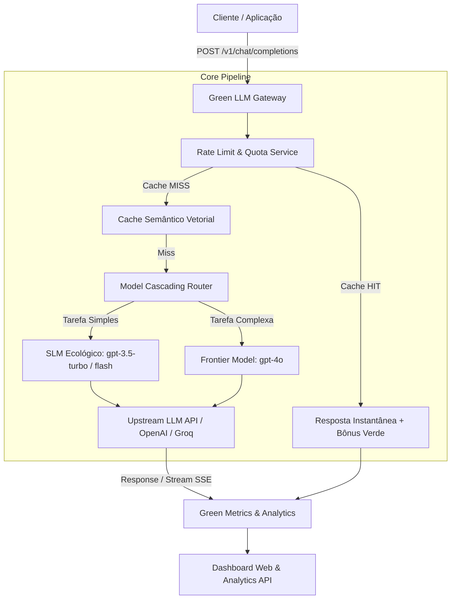

# 🌱 Green LLM Gateway

[](https://nodejs.org/)
[](https://www.typescriptlang.org/)
[](https://www.fastify.io/)
[](https://opensource.org/licenses/MIT)
[](https://github.com/)

O **Green LLM Gateway** é um Micro-SaaS *open-source* em formato de *reverse proxy* inteligente para APIs de LLM (compatível com OpenAI `/v1/chat/completions`). Projetado sob os pilares de **FinOps** e **GreenOps**, o gateway reduz drasticamente custos financeiros, latência de resposta e pegada de carbono (consumo de energia) em aplicações de Inteligência Artificial.

---

## 🏛️ Arquitetura do Sistema



---

## 🚀 Pilares Técnicos Principais

1. **Cache Semântico Vetorial (`all-MiniLM-L6-v2`)**:
   - Gera embeddings locais e calcula similaridade de cosseno (threshold $\ge 0.90$).
   - Prompts semanticamente equivalentes retornam instantaneamente em milissegundos, zerando o custo de processamento e a emissão de carbono daquela chamada.

2. **Model Cascading (Roteamento Dinâmico)**:
   - Analisa heurísticas de complexidade do prompt (contagem de caracteres, blocos de código, palavras-chave analíticas).
   - Prompts triviais e saudações são redirecionados automaticamente para Modelos Pequenos e Eficientes (SLMs), reduzindo o consumo de energia em até **70%**.

3. **Streaming Nativo (Server-Sent Events / SSE)**:
   - Suporte completo a `stream: true` tanto para Cache HIT quanto para Cache MISS com *pipe* em tempo real e reconstrução em background para alimentar o cache semântico.

4. **Rate Limiting & Green Quotas**:
   - Gerenciamento de cotas por API Key / Cliente.
   - **Bônus Verde**: Requisições atendidas via Cache Semântico (`Cache HIT`) não descontam da cota de orçamento/tokens e não consomem o rate limit do cliente.

5. **Métricas de Sustentabilidade (Green Metrics)**:
   - Cálculo dinâmico de energia poupada em kWh ($\approx 0.0003 \text{ kWh}$ por chamada pesada evitada), carbono evitado em $\text{gCO}_2\text{e}$ (baseado na média global de $475 \text{ gCO}_2\text{e}/\text{kWh}$) e economia financeira.

---

## 📦 Guia de Instalação e Execução

### 1. Clonar e Instalar Dependências
```bash
git clone https://github.com/seu-usuario/green-llm-gateway.git
cd green-llm-gateway
npm install
```

### 2. Configurar Variáveis de Ambiente
Crie um arquivo `.env` na raiz baseando-se no `.env.example`:
```env
PORT=3000
HOST=0.0.0.0
UPSTREAM_API_URL=https://api.openai.com/v1
UPSTREAM_API_KEY=sua-chave-api-openai-aqui
SEMANTIC_CACHE_ENABLED=true
CACHE_SIMILARITY_THRESHOLD=0.90
MODEL_CASCADING_ENABLED=true
DEFAULT_SLM_MODEL=gpt-3.5-turbo
DEFAULT_FLM_MODEL=gpt-4o
```

### 3. Executar em Modo de Desenvolvimento
```bash
npm run dev
```

O servidor estará rodando em `http://localhost:3000`. Acesse a raiz (`http://localhost:3000/`) para visualizar o **Dashboard de Sustentabilidade**.

---

## 📡 Exemplos de Uso via PowerShell / cURL

### Chat Completions (Non-Streaming)
```powershell
curl.exe -X POST http://localhost:3000/v1/chat/completions `
  -H "Content-Type: application/json" `
  -H "X-Green-Client-Key: client-alpha" `
  -d '{"model": "gpt-4o", "messages": [{"role": "user", "content": "Qual a capital do Brasil?"}]}'
```

### Chat Completions com Streaming (SSE)
```powershell
curl.exe -X POST http://localhost:3000/v1/chat/completions `
  -H "Content-Type: application/json" `
  -H "X-Green-Client-Key: client-alpha" `
  -d '{"model": "gpt-4o", "stream": true, "messages": [{"role": "user", "content": "Escreva um poema curto sobre sustentabilidade."}]}'
```

### Consultar Analytics via API
```powershell
curl.exe http://localhost:3000/v1/green/analytics
```

---

## 🐳 Docker (Deploy Pronto para Nuvem)

Para realizar o build e executar via Docker:

```bash
docker build -t green-llm-gateway .
docker run -p 3000:3000 --env-file .env green-llm-gateway
```

---

## 📄 Licença
Distribuído sob a licença **MIT**. Veja `LICENSE` para mais detalhes.
